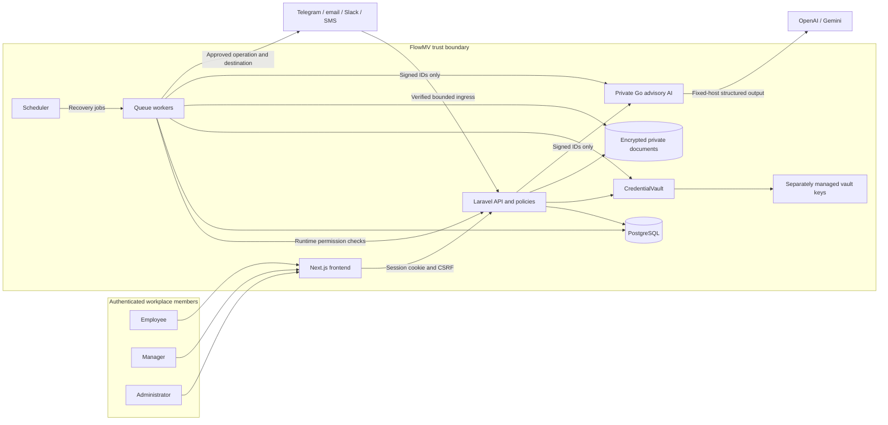
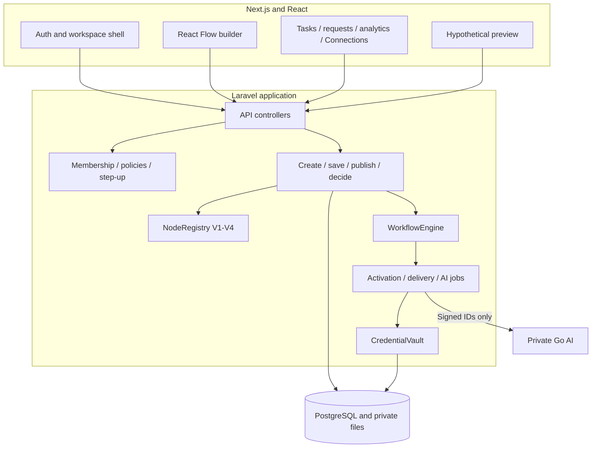
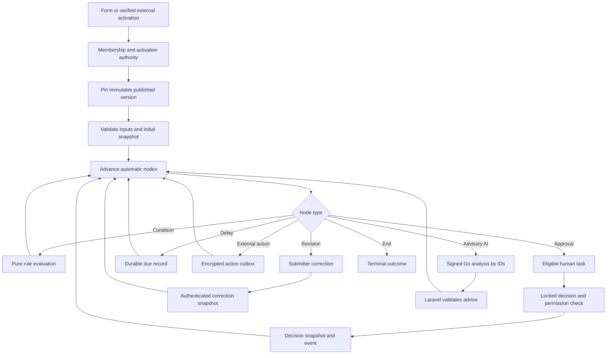
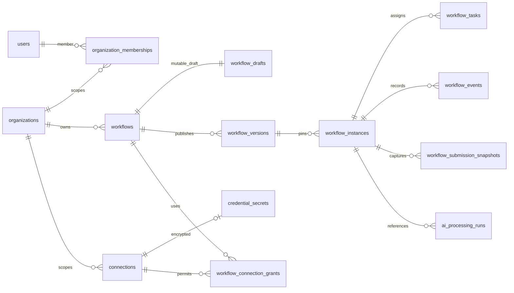
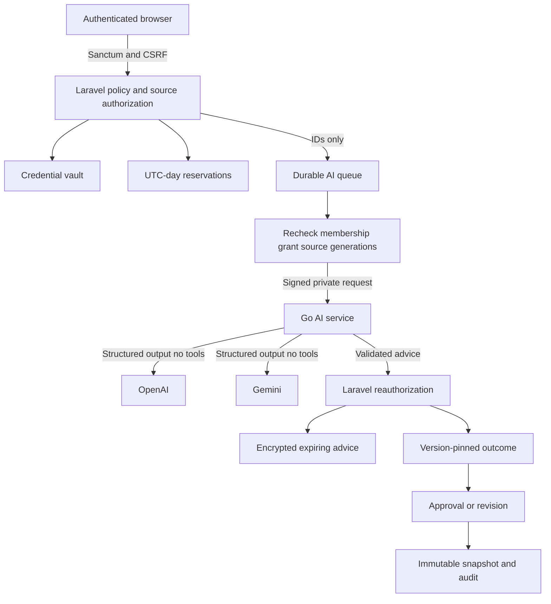
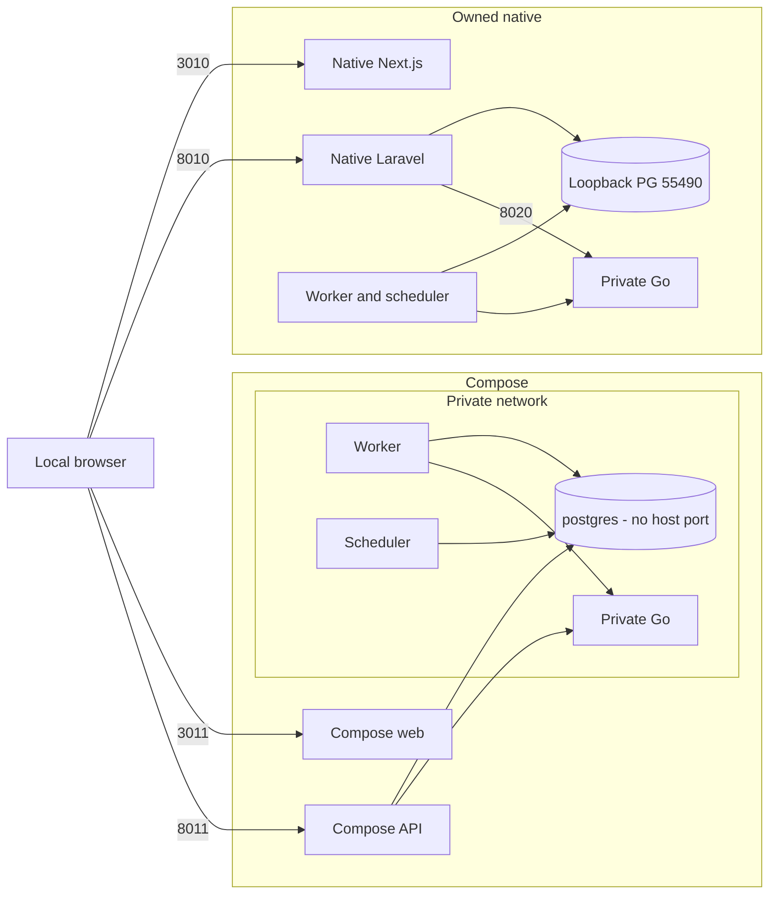

# Architecture

How FlowMV fits together: Next.js UI, Laravel authorization and workflow engine, private Go advisory AI, PostgreSQL, workers and external providers.

**Status:** Implemented for local/simulated showcases. Production deployment is **not cleared**.

## System overview

Authenticated members use the browser only. Laravel owns sessions, policies, workflow decisions and vault custody. Go receives signed ID-scoped requests and never talks to the browser or PostgreSQL.

## Component responsibilities

| Component | Owns |
| --- | --- |
| Next.js / React Flow | Auth shell, builder, Connections UI, tasks/requests/analytics |
| Laravel | Sanctum, RBAC, draft/publish, engine, vault, outboxes, audit |
| Go | Advisory analysis, structured output, prompt isolation, concurrency limits |
| PostgreSQL | Tenants, versions, instances, tasks, events, grants |
| Workers / scheduler | Activation, delivery, AI jobs, recovery |

Preview never calls jobs, vault or Go. Specialist detail: [architecture/go-service.md](architecture/go-service.md), [api/README.md](api/README.md).

## Authentication and permissions

1. Browser obtains CSRF cookie, then logs in with email/password over Sanctum.
2. Organization membership scopes every protected UUID.
3. Policies authorize Admin / Manager / Employee actions.
4. Sensitive connection changes require password step-up (HTTP 428 if stale).
5. Provider use needs Admin approval, destination approval and per-workflow operation grants.
6. Workers recheck membership, grant, generation and destination before transport.

Personal credentials stay hidden from other members, including Admins, on the connection overview.

## Workflow execution

Publication creates an immutable `WorkflowVersion` and pins a NodeRegistry version. Runtime pins that version for every request. Human decisions write decision snapshots and append-only events.

Provider acceptance is not recipient delivery. AI advice never replaces a human decision.

## Database relationships (high level)

Major entities only — not a column-complete schema.

Subsystem ERDs (email, Slack, SMS, AI attributes): [diagrams/database-erd.md](diagrams/database-erd.md).

## Go AI processing

Laravel authorizes sources and budgets, queues ID-only jobs, then calls Go over signed private HTTP. Go talks only to fixed-host OpenAI/Gemini APIs with structured output and no tools. Laravel revalidates results before branching.

Showcase AI responses are simulated. Live-provider quality and billing remain unverified.

## Deployment architecture

### Implemented showcases

### Proposed production (not deployed)

HTTPS reverse proxy, supervised PHP-FPM, restricted DB runtime role, private Go TLS, verified scanners and backup systems remain gates. See [operations-and-security.md](operations-and-security.md) and [operations/production-readiness-checklist.md](operations/production-readiness-checklist.md).
