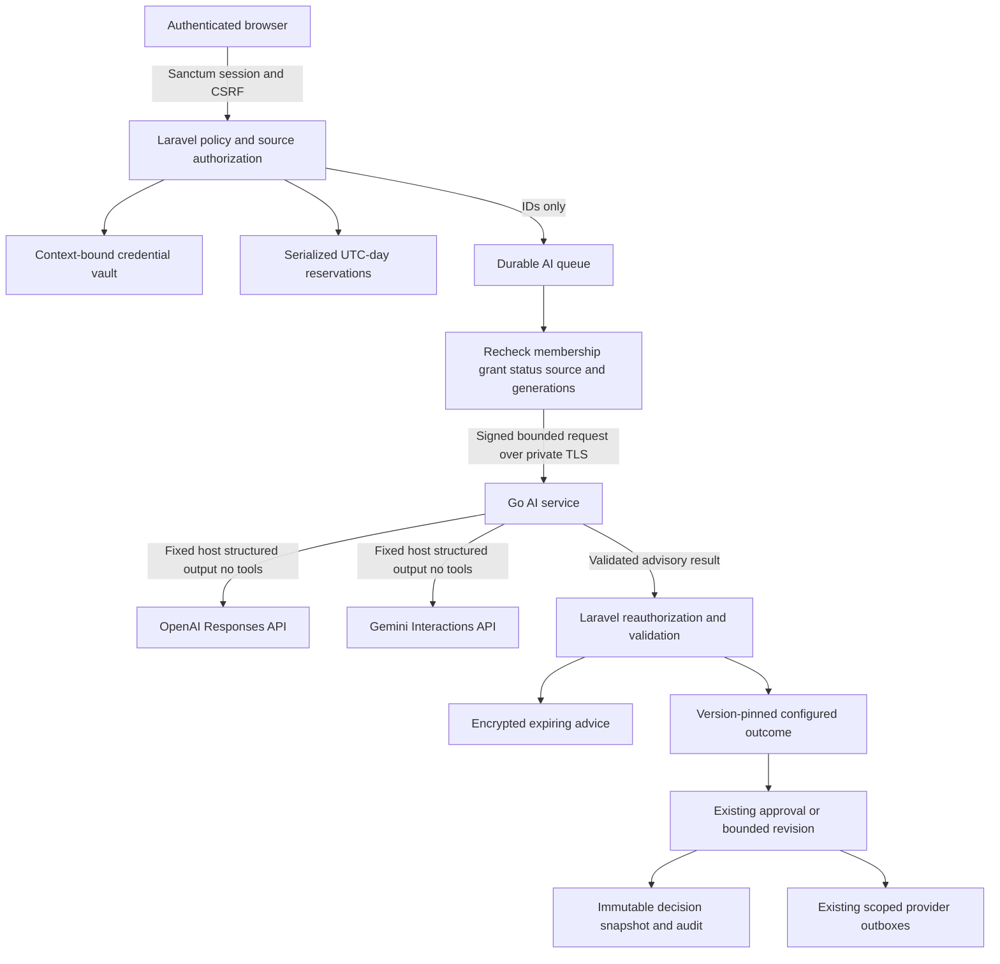
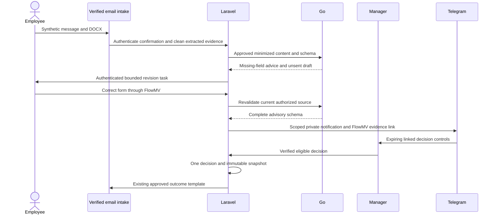
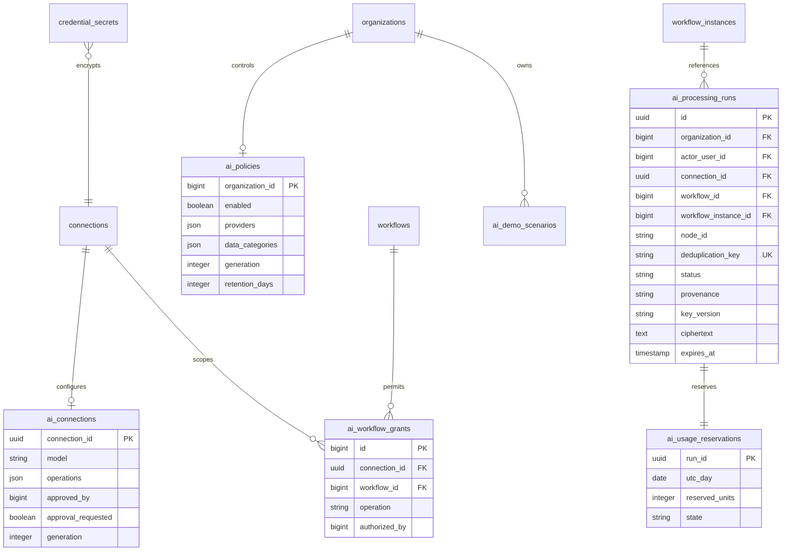
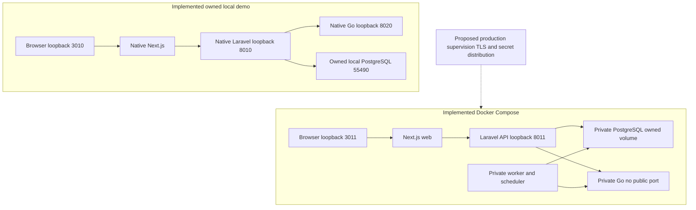

# AI trust boundary and processing

Go receives no database access. Dashed production deployment components are documented separately; this diagram describes the implemented boundary. Demo provider responses and scanners are simulated.

The composed rehearsal exercises this sequence on both owned native and Docker installations, including three AI analyses, a fixed correction email and fixed employee/HR outcome emails. Domain processing and DOCX extraction actually run; provider and scanner responses are simulated. No live-provider chain has been verified.

