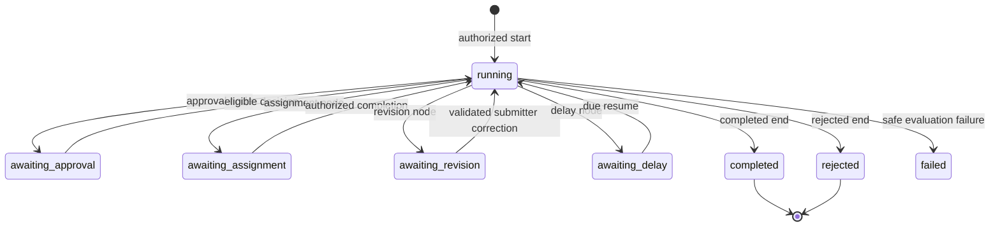
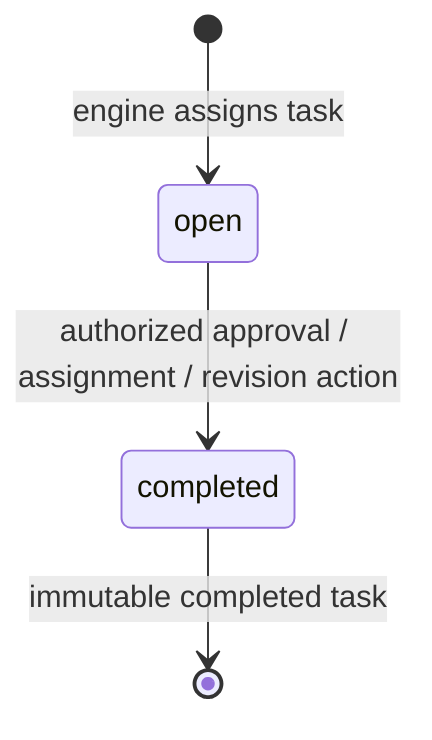

# Request and task lifecycles

These states come from `WorkflowInstanceStatus`, `WorkflowTaskStatus`, `WorkflowEngine` and task actions. The graph's end-node result determines completed/rejected. There is no fabricated automatic recovery transition out of failed.

An approval decision may route to revision rather than rejection. An external provider callback still uses the same locked task action and eligibility checks.
