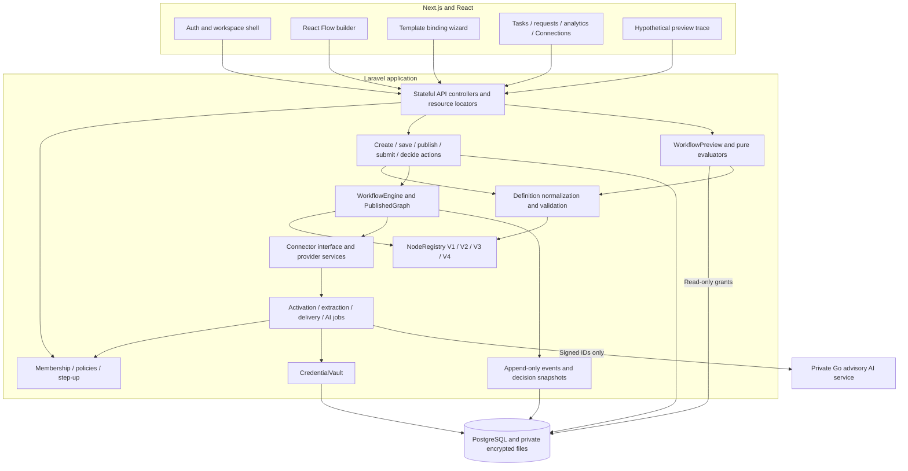

# Component architecture

NodeRegistry V4 covers seven advisory AI node types only; V1/V2/V3 published snapshots retain their contracts. Preview has no edge to jobs, vault, Go or execution handlers. Provider implementations retain their specific authorization boundaries.
