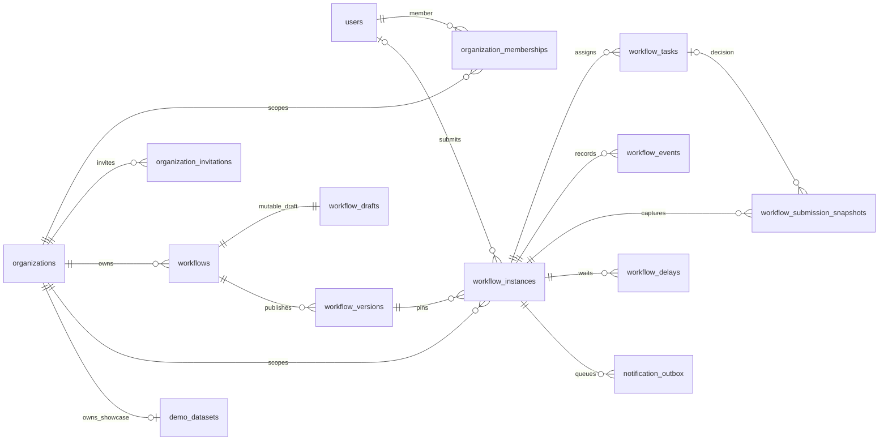
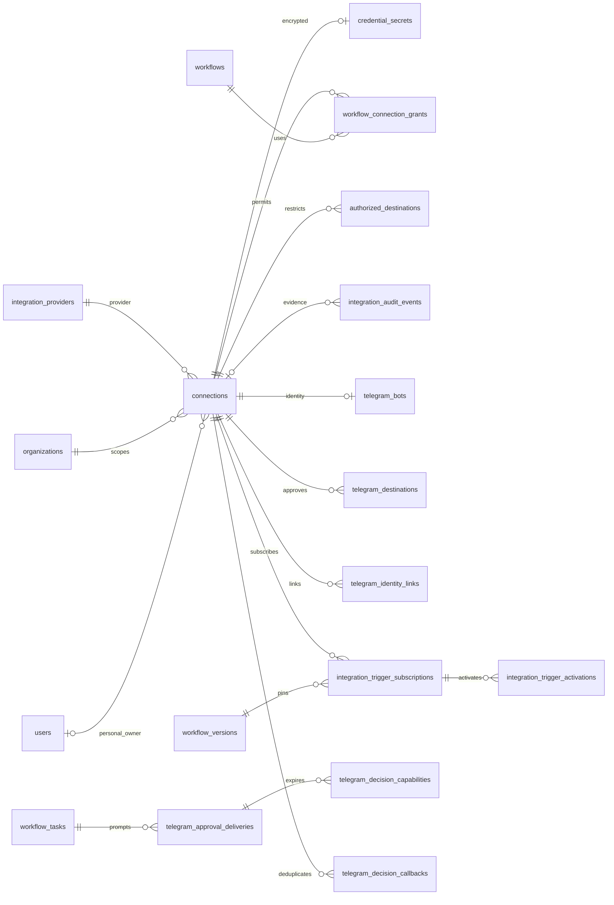
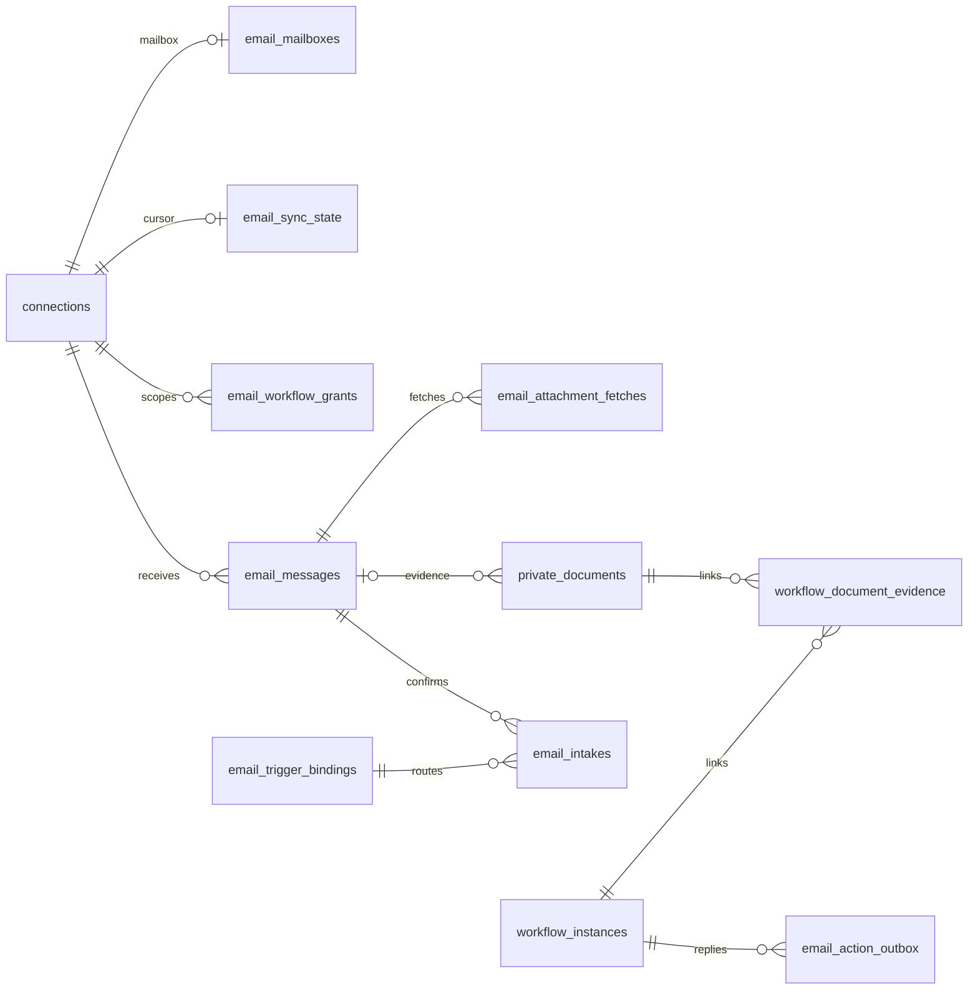
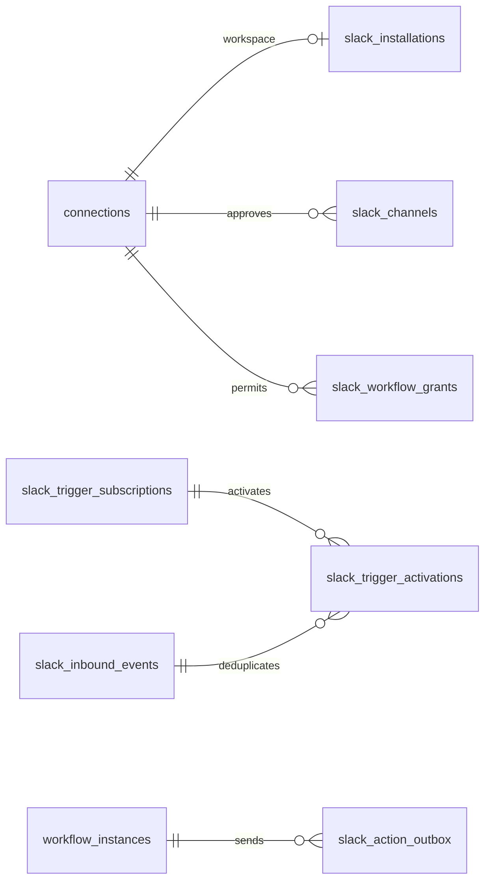
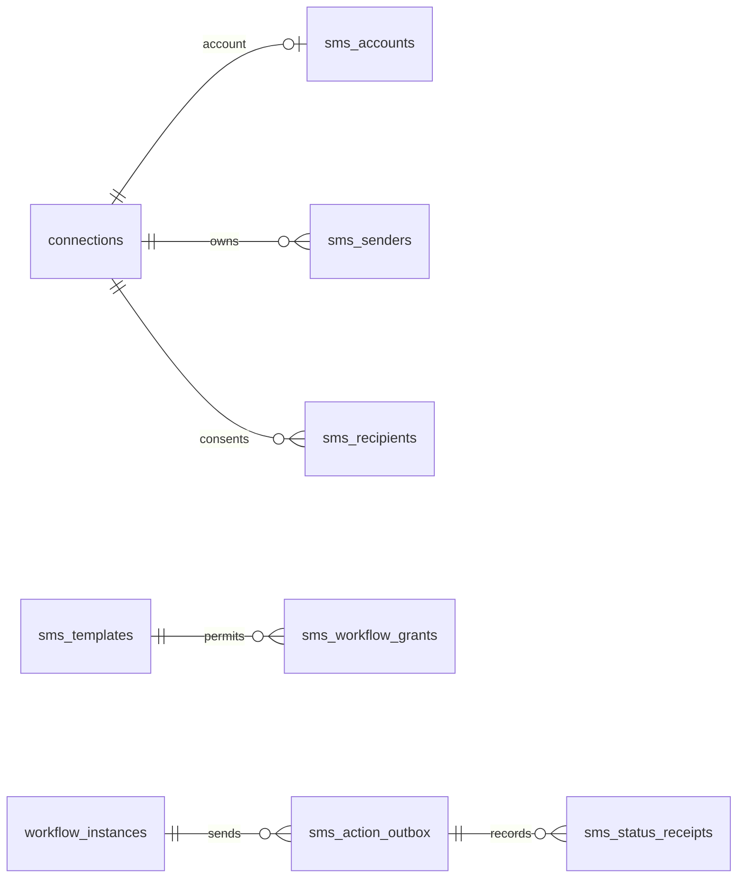
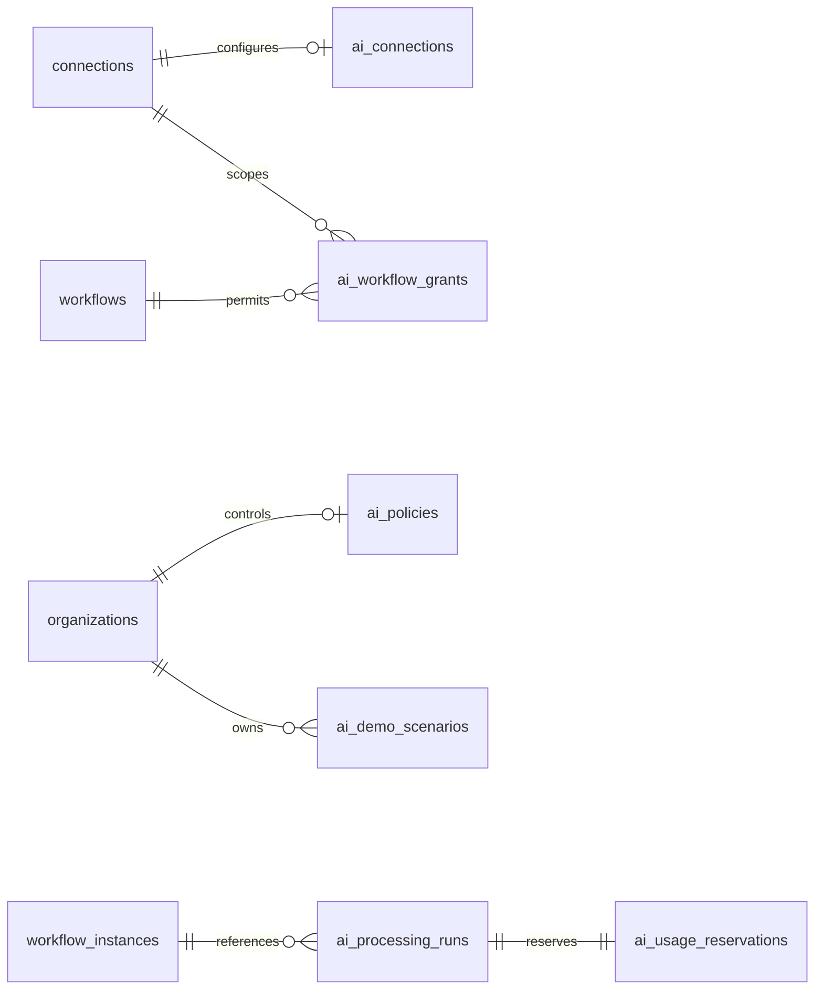

# Database ERDs by subsystem

Relationships are derived from migrations. These are major entities, not a column-complete schema. UUID references and composite organization constraints supplement the shown keys.

## Organization and workflow execution

## Credentials and Telegram

## Email and documents

## Slack

## SMS

## Advisory AI

AI tables come from the AI processing foundation and demo-scenario migrations. Attribute-level detail and trust-boundary diagrams live in [AI processing](ai-processing.md).
