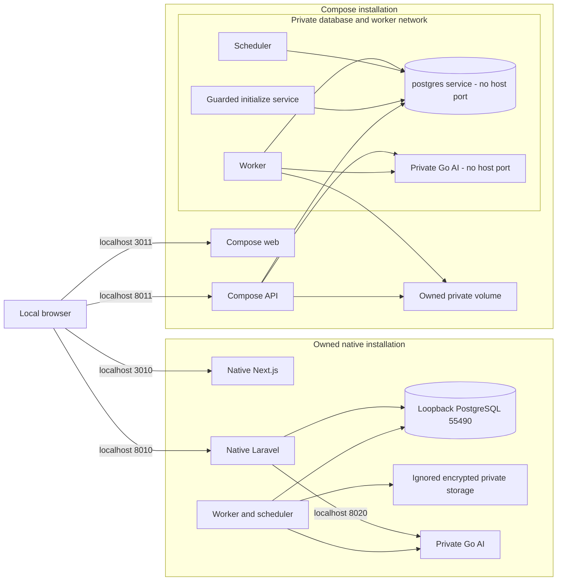
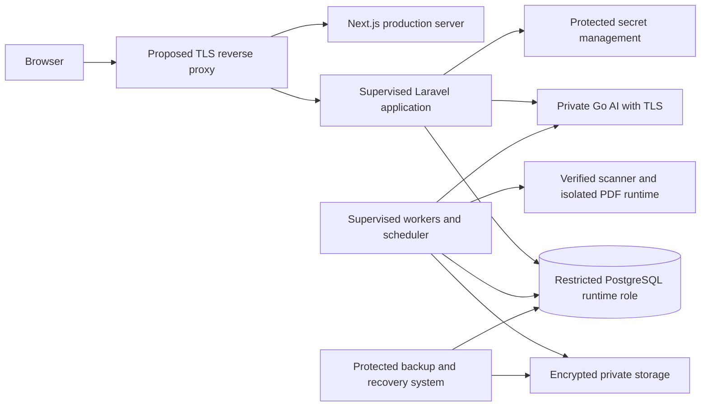

# Deployment topology

## Implemented showcase launch configuration

Both profiles require simulated providers and array mail. Web/API additionally join the ingress bridge for IPv4/IPv6 loopback port publication; workers, database and Go remain on the private network in Compose. Native Go listens on loopback port 8020. Container walkthrough acceptance is a separate result from configuration existing in source. See [AI processing](ai-processing.md) for the trust boundary.

## Proposed production components — not deployed or verified

Production network, runtime grants, secret custody, backups, scanner isolation and supervision require independent validation and deployment approval.
