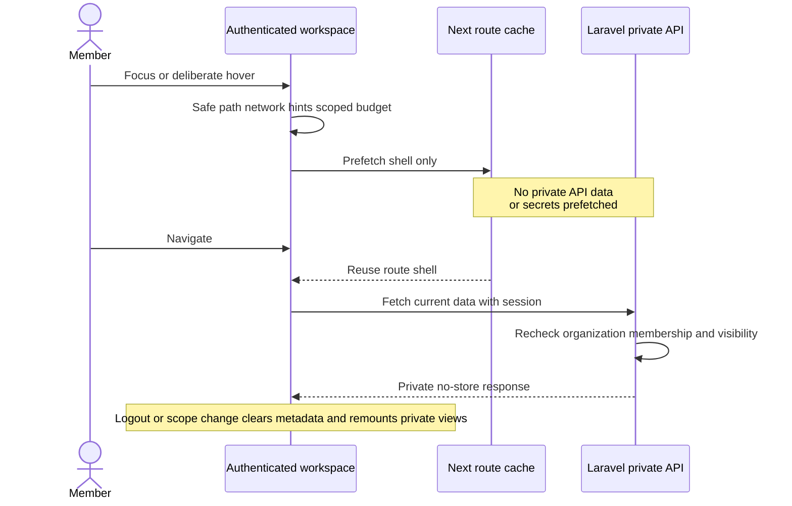
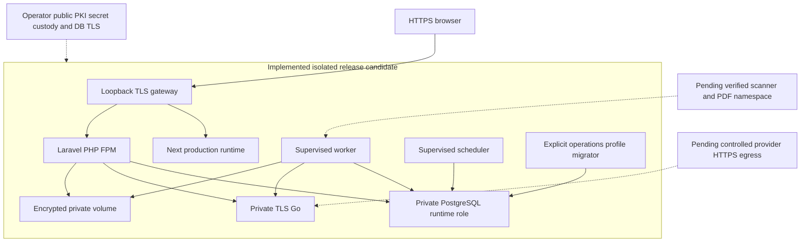
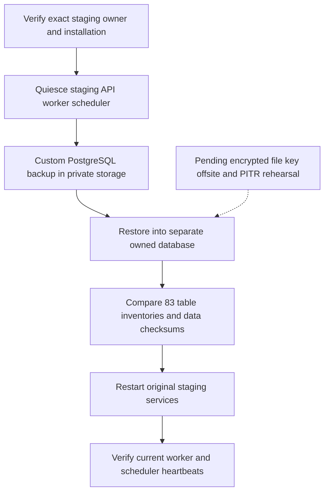

# Intent navigation, release candidate and recovery

Solid paths are implemented local staging behavior; dashed paths are external production gates. The rehearsal never restores over the source or showcase databases. See the [readiness checklist](../operations/production-readiness-checklist.md). Engineering acceptance evidence for these diagrams is recorded in the [final acceptance ledger](../archive/phase12-final-acceptance.md).
