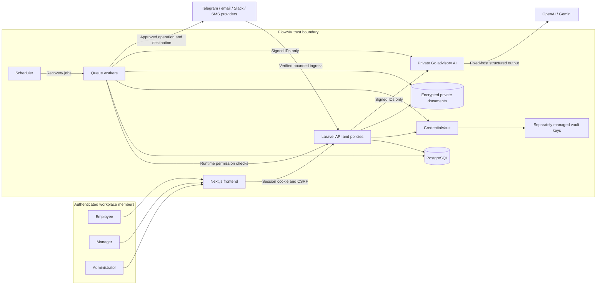

# System context

Derived from session middleware, AppServiceProvider, queue jobs, Compose and the private Go advisory service.

Laravel remains the authorization and decision boundary. The browser never calls Go. The demo substitutes guarded synthetic transports and scanner responses. No production trust is established by the diagram.
