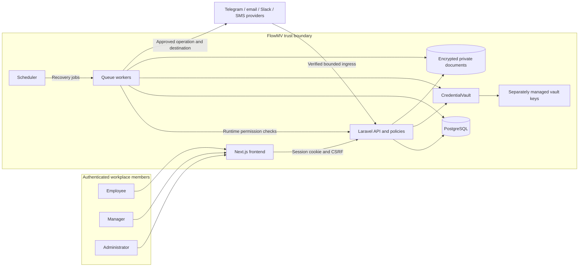

# System context

Derived from session middleware, AppServiceProvider, queue jobs and Compose.

The demo substitutes guarded synthetic transports and scanner responses. No production trust is established by the diagram.
