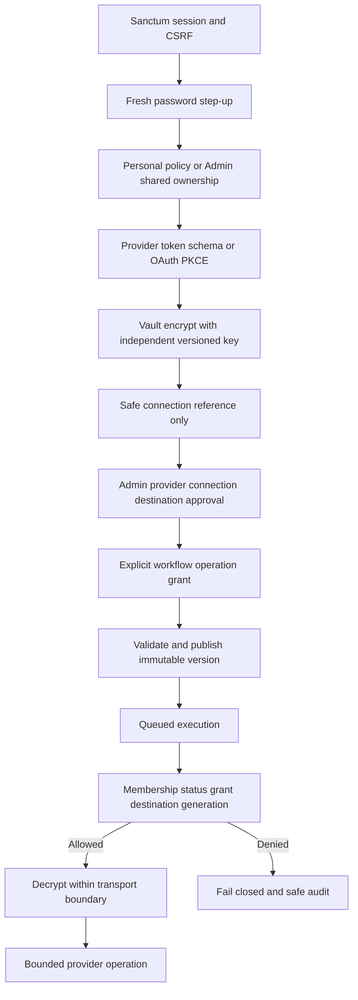
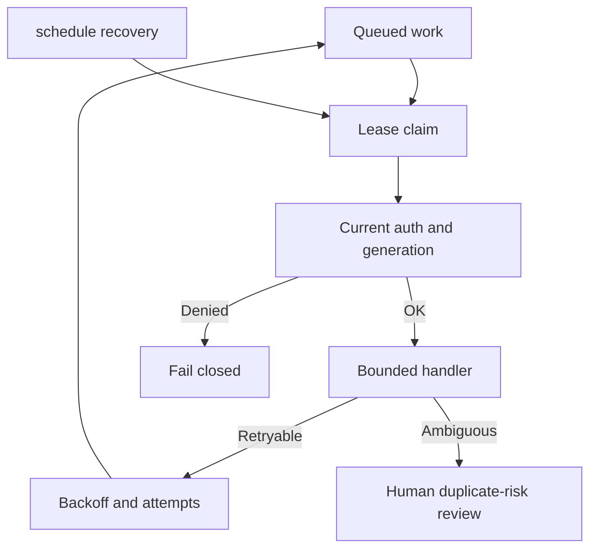
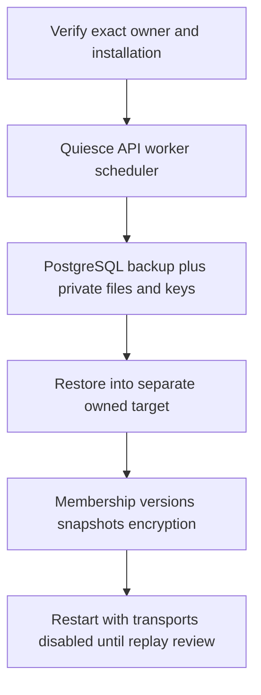
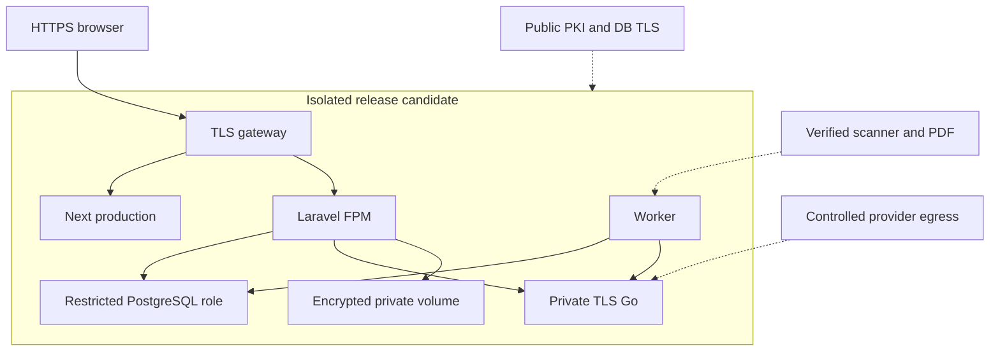

# Operations and security

Trust boundaries, operational practices and production blockers. This overview links to detailed runbooks when a shortened summary would drop a safety step.

**Production status:** Local/simulated engineering accepted. Production is **NOT CLEARED**.

## Authentication and tenant isolation

- Sanctum cookie sessions + CSRF for the browser API.
- Organization membership resolves every tenant-scoped UUID.
- Policies enforce Admin / Manager / Employee capabilities.
- Workspace labels are not authorization.

Specialist: [architecture/security-boundaries.md](architecture/security-boundaries.md).

## Password step-up

Sensitive connection and credential mutations require a fresh password confirmation bound to the signed-in user. Stale confirmation returns HTTP 428. Confirmation expires (five minutes).

## Credential encryption and BYOK

- `APP_KEY` and `INTEGRATION_KEYS` are independent.
- AI connections are BYOK; Go never stores credentials.
- Rotation increments credential generation; old queued work fails closed.

Full vault rotation procedure: [operations/runbooks.md](operations/runbooks.md).

## Provider permissions and webhooks

- Approve provider → connection → destinations → per-workflow grants.
- Webhooks verify signatures/secrets, bound payloads and dedupe IDs.
- Webhooks do not create organization membership.
- Personal credentials are not auto-shared.

## Private documents

Encrypted private storage, bounded DOCX extraction, organization-scoped evidence links. Showcase scanner results are simulated. Production ClamAV and PDF isolation remain gates.

## AI privacy controls

- Browser never calls Go.
- Jobs carry IDs; Laravel rechecks grants before and after Go.
- Fixed-host structured output; no tools; no arbitrary URLs.
- Results encrypted with retention; logs omit bodies and keys.
- Demo requires simulated mode and owned installation markers.

## PostgreSQL access

Least-privilege runtime vs migrator roles. Demo owner role is not a production runtime role. Forward-only migrations; never `migrate:fresh` on demo/QA/hosted targets.

Authoritative guide: [database-access.md](database-access.md). SQL proposal: `backend/database/integration-runtime-permissions.sql`.

## Caching and rate limits

Local default is file cache. Shared multi-node deployments need shared cache for limiters. Details: [cache-and-rate-limits.md](cache-and-rate-limits.md).

## Queue and scheduler reliability

Demo runs `queue:work` and `schedule:work`. Production needs supervised workers and minute `schedule:run`. Inspect `routes/console.php` for schedules. AI recovery: `integrations:recover-ai`.

## Backup and recovery

DB-only restore cannot recover missing documents or vault keys. Local staging restore rehearsal exists; production PITR/off-site remains a gate. Checklist: [operations/production-readiness-checklist.md](operations/production-readiness-checklist.md).

## Secret rotation

1. Inventory encrypted records and key versions.
2. Add new vault key version; keep old for reads.
3. Use bounded `integrations:rotate-keys` against a clone first.
4. Coordinate `AI_SERVICE_KEY` updates with Go restart; pause ambiguous AI retries.
5. Retire old keys only after retention and recovery policy allow.

## Retention and monitoring

- Submission snapshots: [submission-snapshot-retention.md](submission-snapshot-retention.md).
- Monitor failed jobs, lease expiry, outbox errors, rate limits, OAuth reauthorization — without logging private bodies.
- Incident response: restrict connection, pause intake, revoke tokens, preserve audit; do not auto-resend ambiguous sends.

## Deployment trust boundaries

Solid paths: implemented local candidate. Dashed: external production gates.

## Known production blockers

| Gate | Status |
| --- | --- |
| Live Telegram / email / Slack / SMS verification | Open |
| Live OpenAI / Gemini quality and billing | Open |
| Production PKI, DB TLS, secret custody | Open |
| Verified ClamAV / PDF isolation | Open |
| Retention sign-off, alerts, PITR / off-site backup | Open |
| Independent accessibility / penetration testing | Open |
| Explicit deployment approval | Open |

Track in [reference/outstanding-work.md](reference/outstanding-work.md). Security review evidence: [security/final-security-review.md](security/final-security-review.md). Detailed procedures: [operations/runbooks.md](operations/runbooks.md).
