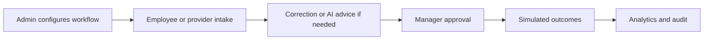

# Showcase guide

Practical MINDCo demonstration of FlowMV. Use synthetic data only. Never paste generated passwords into tracked docs or screenshots.

## Start the showcase

### Native

```powershell
composer install --working-dir=backend
npm ci --prefix frontend
node scripts/demo-setup.mjs native
node scripts/demo-run.mjs
```

Open `http://localhost:3010`. Accounts file (private): `backend/storage/app/phase10-demo/native/accounts.json`.

### Docker

```powershell
node scripts/demo-container.mjs up
node scripts/demo-container.mjs verify
```

Open `http://localhost:3011`. Read accounts only in your own terminal via the API container; do not publish them.

## Synthetic accounts and role switching

Typical emails (passwords only in the ignored manifest):

| Role | Example email |
| --- | --- |
| Admin | `mindco.admin1@example.com` |
| Manager | `mindco.manager1@example.com` |
| Employee | `mindco.employee1@example.com` |

Switch roles with ordinary **Log out → Sign in**. There is no authorization-bypass role switcher.

Confirm the compact **Demo** control beside the workspace switcher. It should say that requests and decisions are real, and that email, Slack, Telegram, SMS, document scanning, and AI provider transport are simulated. There is no full-width banner.

## What is real vs simulated

| Real | Simulated |
| --- | --- |
| Requests, tasks, decisions, snapshots, audit | Email / Slack / Telegram / SMS provider HTTP |
| Organization RBAC and Connections grants | Antivirus / PDF sandbox results |
| Bounded DOCX parsing | Paid OpenAI / Gemini inference |
| Queue workers and outbox machinery | Live recipient delivery |

## Demo journey



## Functional scenarios

### 1. Workflow builder

1. Sign in as Admin → **Workflows → Explore templates**.
2. Create a named draft; inspect fields and approval; tidy / undo; save.
3. Open **Preview safely**, fill synthetic answers, assume approved — confirm no request was created.
4. Publish only after validation. Expected: new immutable version; pristine seed counts may drift.

### 2. Email and document correction

1. Admin → **Connections → Email**; use simulated event controls for the seeded employee sender / missing-info case.
2. Employee confirms intake while authenticated; completes revision task.
3. Manager approves.
4. Expected: real DOCX parse path, simulated scanner and provider acceptance, decision snapshot.

### 3. Slack → Telegram → SMS

1. Admin → Slack simulated event with seeded linked sender and fresh event key.
2. Manager decides in FlowMV or via simulated Telegram buttons before expiry.
3. Show Slack/SMS delivery history as simulated acceptance.
4. Re-submit same event key → no second request.
5. Expected: one pinned request; fail-closed behavior for unsigned/unlinked/revoked cases.

### 4. AI email / document demonstration

With launcher running:

```powershell
cd backend
php artisan demo:ai-seed --env=demo --no-interaction
php artisan demo:ai-seed --verify --env=demo --no-interaction
```

Optional composed rehearsal: `php artisan demo:ai-seed --rehearse --env=demo --no-interaction`.

Walk Connections → OpenAI & Gemini, then Employee revision advice and Manager evidence. Never present model advice as a decision. AI provider responses are simulated.

### 5. Analytics and audit

Admin → **Analytics** (date range covering fixture clock) and **Audit**. Expected: cohort suppression, UTC grouping, append-only events without private message bodies.

## Expected outcomes checklist

| Scenario | Pass signal |
| --- | --- |
| Builder preview | Trace + fingerprint; no new request |
| Email correction | Revision task → Manager decision → simulated replies |
| Slack journey | One request; duplicate key ignored |
| AI seed | Scenario ledger verify without overwrite |
| Roles | Employee cannot publish/admin shared providers |

## Common demo troubleshooting

| Issue | Action |
| --- | --- |
| Cannot log in | Use ignored accounts file for the **same** profile (native vs Docker) |
| Worker idle | Confirm launcher still running; wait for queue |
| Ownership errors | Re-run setup verify; do not reset volumes |
| Stale ports | Free 3010/8010 or 3011/8011; launchers do not kill foreign PIDs |
| Banner missing | Wrong environment — not the guarded demo |

## 10–15 minute presentation script

| Time | Talk track |
| --- | --- |
| 0–1 min | Banner: real Laravel records; simulated providers. Show navigation. |
| 1–4 min | Templates → draft → preview (no side effects) → publish / version pin. |
| 4–8 min | Email missing-info → Employee correction → Manager approve → simulated delivery. |
| 8–11 min | Slack intake → Telegram or in-app decision → Slack/SMS outcomes; duplicate event. |
| 11–14 min | Analytics + audit snapshot; Employee role boundary. |
| 14–15 min | Disclose simulation limits; production NOT CLEARED; live-provider gates open. |

Optional AI addendum: Connections AI, incomplete application advice, composed rehearsal timeline.

Full launcher notes: [quick-start.md](quick-start.md). Historical evidence: [archive/](archive/README.md).
