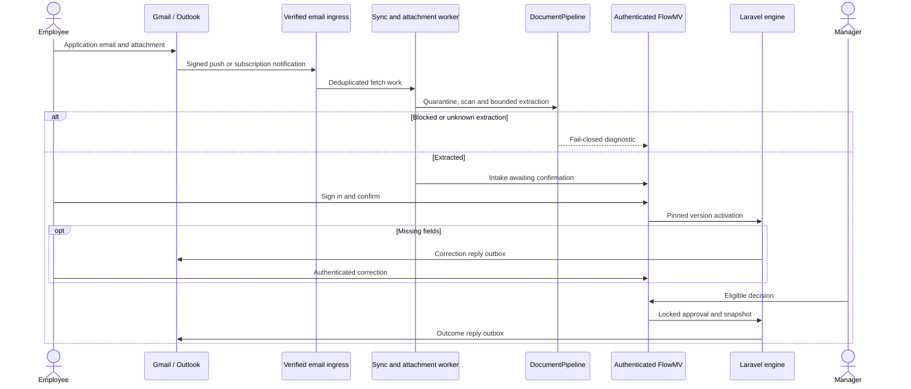
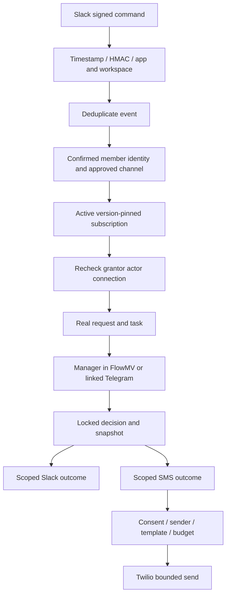
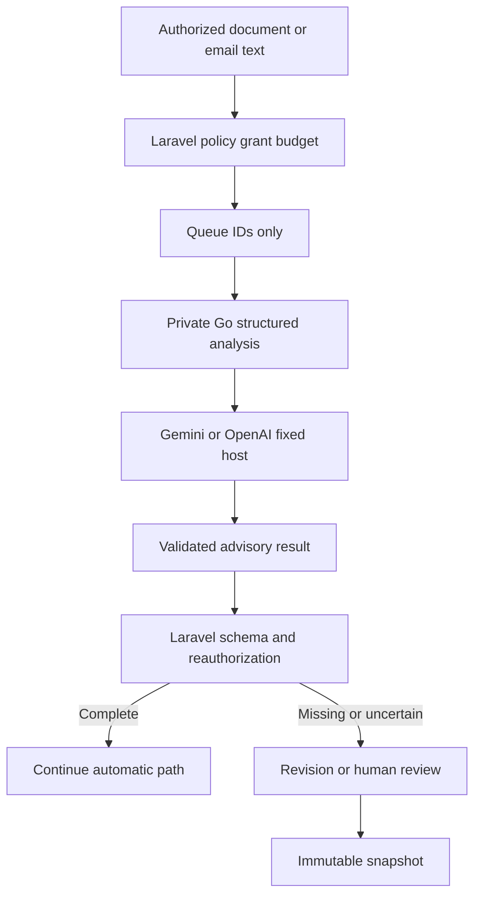
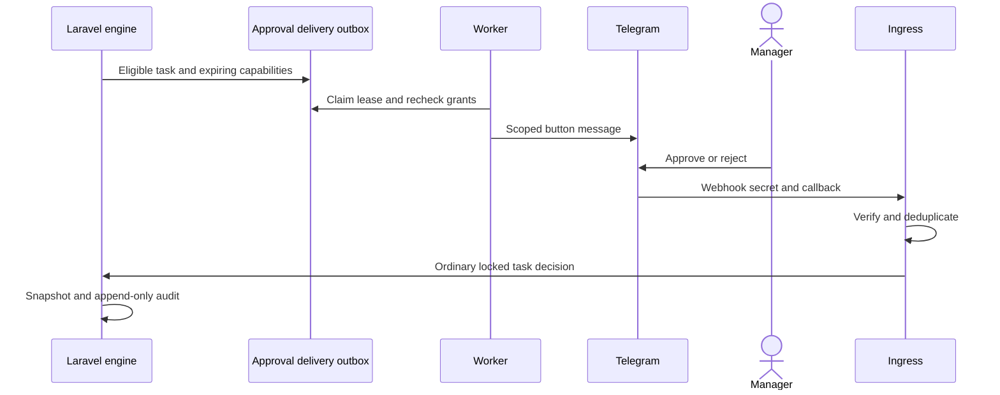
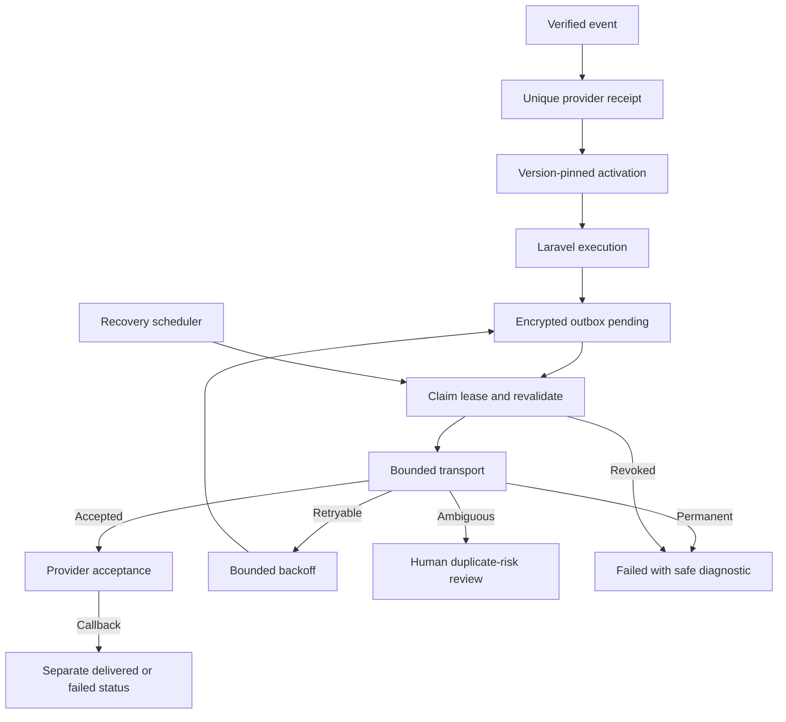

# Workflows and integrations

How FlowMV models work, connects providers and runs advisory AI. Showcase traffic is **simulated** unless an independent live test is recorded.

## Workflow builder

Admins design graphs in React Flow: search palette, tidy layout, undo/redo, validation and unsaved-change protection. Templates create drafts only — they never publish or grant credentials. Hypothetical preview traces branches without jobs, vault decryption or domain writes.

Product walkthrough: [guides/roles-and-workflows.md](guides/roles-and-workflows.md). API: [api/README.md](api/README.md).

## Node categories and registry

| Registry | Scope |
| --- | --- |
| V1 | Form, approval, condition, delay, end |
| V2 | Additional automation nodes |
| V3 | External triggers/actions (email, Slack, Telegram, SMS, …) |
| V4 | Seven advisory AI node types |

Publication stamps the registry version the definition requires. Execution uses the stored snapshot. Unknown versions fail closed. Historical V1–V3 publications are not rewritten.

## Drafts and published versions

1. Create draft → save with revision checks.
2. Admin validates grants and graph.
3. Publish creates an immutable `WorkflowVersion`.
4. New requests pin that version for life.
5. Compare versions shows structural diffs without secrets.

## Approvals, revisions, conditions and delays

- **Approval / assignment:** eligible human task; locked decision; no self-approval where configured.
- **Revision:** submitter correction with bounded return budget.
- **Condition / filter:** pure in-process evaluation.
- **Delay:** durable due record resumed by authorized jobs.
- **External action:** encrypted outbox with rechecked grants.

## Connections and permissions

Connections hold encrypted credentials (personal or organization-owned). Admins approve providers, connections and destinations. Each workflow needs explicit operation grants before publish. Workers recheck everything at send time. Disable pauses work; revoke removes secrets and grants.

Detailed connector development: [integrations/README.md](integrations/README.md).

---

## Flowchart A — Leave application (email and documents)

Email intake → attachment inspection → validation → missing-information correction → revalidation → manager approval → notification.

**Showcase:** Laravel processing and DOCX parsing are real; provider responses and antivirus/scanner results are simulated. Live Gmail/Outlook remain separate gates.

---

## Flowchart B — Slack automation

Authorized Slack message → validation → identity → workflow → approval → outcome (Slack/SMS).

**Showcase:** Synthetic Slack/SMS transports; domain actions and outboxes are real. Live Slack/Twilio verification pending.

---

## Flowchart C — AI-assisted document review

Safe document → Go AI → structured extraction → deterministic checks → human review or continuation.

**Showcase:** AI provider responses are simulated. DOCX extraction and Laravel branching are real. Live AI quality/billing unverified. Setup: [integrations/ai.md](integrations/ai.md).

---

## Flowchart D — Telegram approvals

Task created → Telegram buttons → identity verification → Laravel decision → audit.

Buttons cannot authorize an unlinked user. Telegram acceptance is not exactly-once delivery.

---

## Flowchart E — Failure handling

External event → validation → queue → retry/recovery → delivered / uncertain / failed.

Never infer recipient delivery from local acceptance alone.

---

## Provider summary

| Provider | Credential boundary | Showcase |
| --- | --- | --- |
| Telegram | Bot token; approved chat; linked identity for decisions | Simulated |
| Gmail / Outlook | OAuth + approved reply addresses | Simulated |
| Slack | OAuth bot; approved channel; confirmed member | Simulated |
| SMS | Twilio credentials; consented recipient; template/budget | Simulated |
| OpenAI / Gemini | BYOK connection; scoped operations; no tools | Simulated |

## Simulation vs live

| Real in showcase | Simulated |
| --- | --- |
| Laravel requests, tasks, decisions, snapshots, outboxes | Provider HTTP responses |
| Bounded DOCX extraction | Antivirus / PDF sandbox |
| Auth, RBAC, grants, audit | Live mailbox/bot/SMS delivery |
| Go signing and Laravel AI branching | Paid model inference |

Live-provider verification remains open in [reference/outstanding-work.md](reference/outstanding-work.md).
